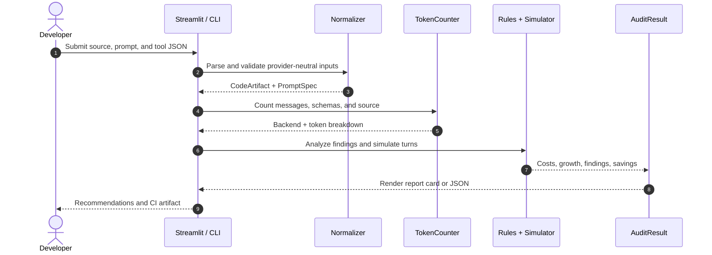

# Agent Token Optimizer

> **Make every agent token earn its place.**

Agent Token Optimizer is a local-first developer tool for auditing the token
footprint and projected cost of AI-agent code, prompts, tool schemas, and
multi-turn loops. It provides both a polished Streamlit workspace and a
deterministic JSON CLI for CI pipelines.

**Status:** MVP scaffold · **Runtime:** Python 3.11 · **Interface:** Streamlit + CLI

## What it delivers

- Token estimates for messages, tool schemas, source code, and total analyzed footprint.
- Configurable one-turn pricing and deterministic multi-turn cost simulation.
- Explicit tool-call/result overhead modeling for agent loops.
- Static findings for duplicate context, verbose instructions, bloated schemas, and dynamic prompt prefixes that can defeat caching.
- Actionable recommendations with locations, estimated savings, and downloadable JSON reports.
- A shared audit pipeline so UI and CI results use the same parser, counter, simulator, and rules.

The MVP is intentionally provider-neutral. It does not call an LLM, send
uploaded content anywhere, or require provider SDKs.

## Contents

- [Architecture at a glance](#architecture-at-a-glance)
- [Ingestion and tokenization design](#ingestion-and-tokenization-design)
- [Setup](#setup)
- [Run the UI](#run-the-ui)
- [Run the CLI](#run-the-cli)
- [Test and CI checks](#test-and-ci-checks)
- [Container deployment](#container-deployment)
- [MVP execution roadmap](#mvp-execution-roadmap)
- [Known MVP gaps](#known-mvp-gaps)

## Architecture at a glance

```mermaid
flowchart LR
    U["Developer<br/>code / prompt / tools"]:::input

    subgraph EXPERIENCE["Developer experience"]
        UI["Streamlit workspace<br/>app.py"]:::surface
        CLI["CI / local CLI<br/>agent-token-audit"]:::surface
    end

    subgraph PIPELINE["Shared deterministic audit pipeline"]
        ORCH["run_audit<br/>AuditResult"]:::orchestrator
        PARSE["Normalize inputs<br/>parsing.py"]:::core
        COUNT["Count tokens<br/>tiktoken or fallback"]:::core
        RULES["Analyze anti-patterns<br/>rules.py + code_rules.py"]:::analysis
        SIM["Simulate turns and cost<br/>simulation.py"]:::analysis
    end

    subgraph OUTPUTS["Actionable outputs"]
        REPORT["Token Audit Report Card<br/>findings + savings"]:::output
        JSON["Versionable JSON<br/>CI artifact"]:::output
    end

    U --> UI
    U --> CLI
    UI --> ORCH
    CLI --> ORCH
    ORCH --> PARSE
    PARSE --> COUNT
    PARSE --> RULES
    COUNT --> RULES
    COUNT --> SIM
    RULES --> REPORT
    SIM --> REPORT
    REPORT --> JSON

    classDef input fill:#0f172a,stroke:#38bdf8,color:#f8fafc,stroke-width:2px;
    classDef surface fill:#1d4ed8,stroke:#93c5fd,color:#eff6ff,stroke-width:2px;
    classDef orchestrator fill:#7c3aed,stroke:#c4b5fd,color:#faf5ff,stroke-width:2px;
    classDef core fill:#0f766e,stroke:#5eead4,color:#f0fdfa,stroke-width:2px;
    classDef analysis fill:#b45309,stroke:#fcd34d,color:#fffbeb,stroke-width:2px;
    classDef output fill:#166534,stroke:#86efac,color:#f0fdf4,stroke-width:2px;
```



### Audit lifecycle



### Responsibilities

| Layer | Responsibility |
| --- | --- |
| `app.py` | Polished local UI, upload/paste controls, friendly parse errors, sidebar assumptions, report-card rendering, and export. |
| `audit_cli.py` | Shared `run_audit` adapter, serializable `AuditResult`, input-file handling, and the `agent-token-audit` entrypoint. |
| `src/agent_token_optimizer/models.py` | Immutable validated domain objects for messages, tools, prices, simulation, and findings. |
| `parsing.py` | Normalizes fenced/plain source, provider-shaped messages, text parts, and OpenAI-style or raw JSON tool schemas. |
| `token_counting.py` | Uses local `tiktoken` if available; falls back to a deterministic UTF-8 estimate without network access. |
| `rules.py` | Deterministic duplicate-message, verbose-message/description, and bloated-tool-schema checks. |
| `code_rules.py` | Conservative Python AST and non-Python text checks for dynamic prompt/header values that can defeat prefix caching. |
| `simulation.py` | Projects input growth and cost across repeated turns without contacting a model. |
| `tests/` | Regression coverage for parsing, rules, token accounting, and simulation. |

The root `audit_cli.py` is a source-checkout wrapper; the packaged
implementation lives at `src/audit_cli.py` so the console script works with
the `src/` layout.

The core package is deliberately unchanged by the UI scaffold. New presentation and orchestration code depends only on its public API.

### Target production expansion

The MVP keeps the dependency surface small by using a flat package. The next
module boundary should expand it into the following independently testable
packages without changing the normalized domain objects:

```text
src/agent_token_optimizer/
├── parsers/       # Python/JS AST adapters, prompt loaders, provider schemas
├── tokenizers/    # tiktoken and provider-specific counting adapters
├── simulators/    # graph traversal, memory growth, retries, tool-call paths
├── analyzers/     # rules, caching, routing, schema and attribution analysis
├── reporters/     # JSON, SARIF, Markdown/PR annotations
└── ui/            # Streamlit pages and reusable report-card components
```

`PromptSpec`, `ToolDefinition`, and `CodeArtifact` are the stable contracts
between those boundaries. A future graph adapter should emit an execution plan
(nodes, edges, loop bounds, and tool calls) that the simulator can evaluate
without executing application code. Provider pricing/tokenizer adapters should
be selected explicitly and versioned with the audit report.

## Ingestion and tokenization design

1. **Code ingestion**
   - A file upload is decoded as UTF-8 and takes precedence over pasted source.
   - `parse_code` removes one outer Markdown fence while preserving the body and indentation.
   - Language is selected from the sidebar when specified, otherwise inferred from a fence marker or file suffix.
   - Source code is counted as an analyzed footprint; it is not silently added to the billable prompt total.

2. **Prompt ingestion**
   - Plain text becomes one `user` message.
   - A JSON string can be a message list, a single `{role, content}` object, or a provider-shaped `{messages: [...]}` object.
   - Common text-part content arrays are flattened without importing a provider SDK.
   - Invalid roles, shapes, or content produce an in-UI error rather than a failed app session.

3. **Tool ingestion**
   - The UI and CLI accept a single JSON object, an array, or `{ "tools": [...] }`.
   - OpenAI-style `{ "type": "function", "function": {...} }` schemas and direct `{name, description, parameters}` definitions are normalized.
   - A separately supplied tool field replaces embedded prompt tools, making the source of truth explicit.

4. **Counting**
   - `TokenCounter` uses `cl100k_base` through an optional local `tiktoken` install.
   - When `tiktoken` or that encoding is unavailable, the core uses `ceil(UTF-8 bytes / 4)` with a minimum of one for non-empty text. This is stable and clearly labeled as an estimate.
   - Message overhead and serialized tool payloads are counted consistently for the UI and CLI.

5. **Cost and savings**
   - Input and output prices are user-provided currency units per 1,000 tokens.
   - A simulation repeats the baseline prompt and adds assumed response/follow-up history between turns. Optional tool-call count, wrapper, and result-token assumptions model additional tool messages carried into the next turn.
   - Built-in savings are rule estimates. Findings may overlap, so their sum is presented as an opportunity ceiling and should be validated after edits.

6. **Static optimization checks**
   - Tool schemas above the configured token threshold are reported with a schema-specific location and a non-overlapping threshold-based estimate.
   - Python assignments to prompt-like variables are checked with the AST for timestamps, UUIDs, randomness, and other per-request values. JavaScript/TypeScript and other text inputs use a conservative line heuristic.
   - The dynamic-prefix finding recommends keeping stable system/developer instructions and tool definitions in a cacheable prefix while moving request metadata later in the request or into provider metadata.

## Setup

Python 3.11 is pinned in `.python-version`. The lock file contains the application and test dependency resolution.

### Reproducible local setup

```bash
python3.11 -m venv .venv
. .venv/bin/activate
python -m pip install --upgrade pip
python -m pip install -r requirements.lock
python -m pip install --no-deps -e .
```

On Windows PowerShell, activate with `.venv\\Scripts\\Activate.ps1` instead. The `--no-deps -e .` step installs this local package and its CLI without re-resolving the locked dependencies.

For an actively developing environment where the lock is not required, this is equivalent:

```bash
python -m pip install -e ".[app,test]"
```

The optional `tiktoken` package is not required. If it is absent, the deterministic fallback is used and the selected backend is shown in the report. To enable the local `cl100k_base` backend explicitly, install the tokenizer extra in the project environment:

```bash
python -m pip install -e ".[tokenizer]"
```

### Refreshing the lock

Use the project-local `uv` tool or another environment manager to refresh dependencies intentionally:

```bash
uv pip compile pyproject.toml --extra app --extra test --python-version 3.11 --output-file requirements.lock
```

Review the resulting diff before distributing a new image. Do not install dependencies globally.

## Run the UI

```bash
streamlit run app.py
```

The app opens a local workspace with sample code, a sample prompt, and a sample tool schema. Replace any or all of them, adjust pricing and simulation assumptions in the sidebar, then choose **Run token audit**. Uploaded content is processed in memory by the app process.

If Streamlit is not installed, importing or running the file does not break the core/CLI workflow; it prints the app-extra installation command. The UI itself requires the locked Streamlit dependency.

## Run the CLI

The CLI is useful for smoke checks, CI artifacts, and reproducible audits without a browser:

```bash
agent-token-audit \
  --code-file examples/agent.py \
  --prompt-file examples/prompt.json \
  --tools-file examples/tools.json \
  --input-per-1k 0.15 \
  --output-per-1k 0.60 \
  --turns 3 \
  > audit-report.json
```

The example paths above are illustrative; use your own UTF-8 files. Inline values are also accepted:

For a workload with tool loops, add `--tool-calls-per-turn`, `--tool-result-tokens`, and `--tool-call-overhead-tokens` to make the extra context growth explicit.

```bash
python audit_cli.py \
  --code 'def run(): pass' \
  --prompt 'Summarize the input in three bullets.' \
  --tools '{"name":"lookup","parameters":{"type":"object"}}'
```

Malformed JSON, conflicting inline/file flags, invalid prices, and invalid simulation settings return a non-zero CLI exit with an actionable parser message.

## Test and CI checks

There is one project test command:

```bash
make test
```

It runs an offline-safe bytecode syntax compilation followed by the existing pytest suite. It performs no network calls. The locked test dependency must already be installed during setup. For a fast syntax-only check when pytest is unavailable:

```bash
python -m compileall -q app.py audit_cli.py src tests
```

A minimal CI job can therefore install from `requirements.lock`, install the local package with `--no-deps`, and run `make test`. The CLI can provide an additional deterministic JSON smoke artifact.

## Container deployment

Build and run the Streamlit app with the pinned Python 3.11 base image and locked dependencies:

```bash
docker build -t agent-token-optimizer .
docker run --rm -p 8501:8501 agent-token-optimizer
```

Open <http://localhost:8501>. Runtime pricing and model labels may be supplied as environment variables; start from `.env.example` and pass them through your deployment platform rather than committing a `.env` file:

```bash
docker run --rm -p 8501:8501 \
  -e AGENT_TOKEN_OPTIMIZER_MODEL=gpt-4o-mini \
  -e AGENT_TOKEN_OPTIMIZER_INPUT_PER_1K=0.15 \
  -e AGENT_TOKEN_OPTIMIZER_OUTPUT_PER_1K=0.60 \
  agent-token-optimizer
```

The Docker image runs `streamlit run app.py` on `0.0.0.0:8501`. No provider credentials are needed for this MVP.

## MVP execution roadmap

1. **Scaffold and trust (current)**
   - Establish normalized package models and deterministic fallback counting.
   - Deliver local ingestion for source, prompts, and JSON tools.
   - Render a report card with transparent assumptions and exportable JSON.

2. **Broaden audit coverage**
   - Add configurable rules for repeated tool schemas, unused parameters, low-information descriptions, and oversized examples.
   - Add provider tokenizer adapters behind an explicit optional interface.
   - Add fixture-driven golden reports for representative agent patterns.

3. **Make recommendations measurable**
   - Add a before/after editor or generated compact candidate, with a diff and re-audit.
   - Track baseline versus optimized prompt cost across a chosen workload distribution.
   - Separate overlapping savings into non-overlapping attribution categories.

4. **Production integration**
   - Add authenticated workspace storage only if a deployment needs persistence.
   - Add batch directory/CI auditing with SARIF or PR-comment output.
   - Add provider pricing profiles with explicit version dates and cache/tool-call semantics.

5. **Quality and operations**
   - Add performance budgets for large schemas and long conversations.
   - Add accessibility review for report-card states and keyboard-only flows.
   - Keep the no-network, deterministic test path as the baseline for every release.

## Known MVP gaps

- Token totals are estimates unless the optional local `tiktoken` backend is installed and match the target provider's encoding.
- The code footprint is measured for visibility but is not inferred as a billable prompt unless represented in the prompt/tool input.
- Savings findings are intentionally small and deterministic; they do not rewrite prompts or estimate quality/regression risk.
- Pricing, caching, retries, latency, and provider-specific serialization policies are modeled only through the sidebar assumptions.
